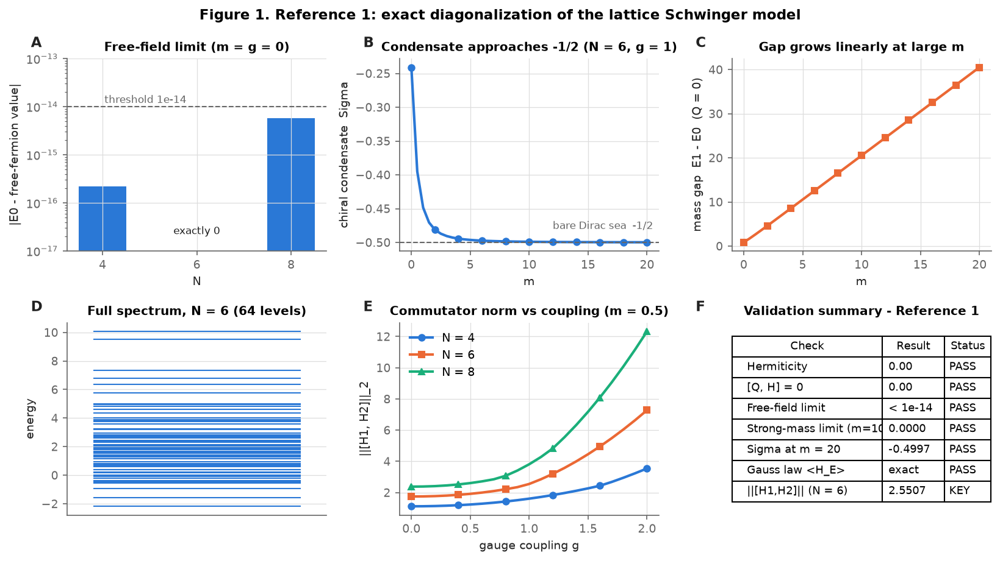
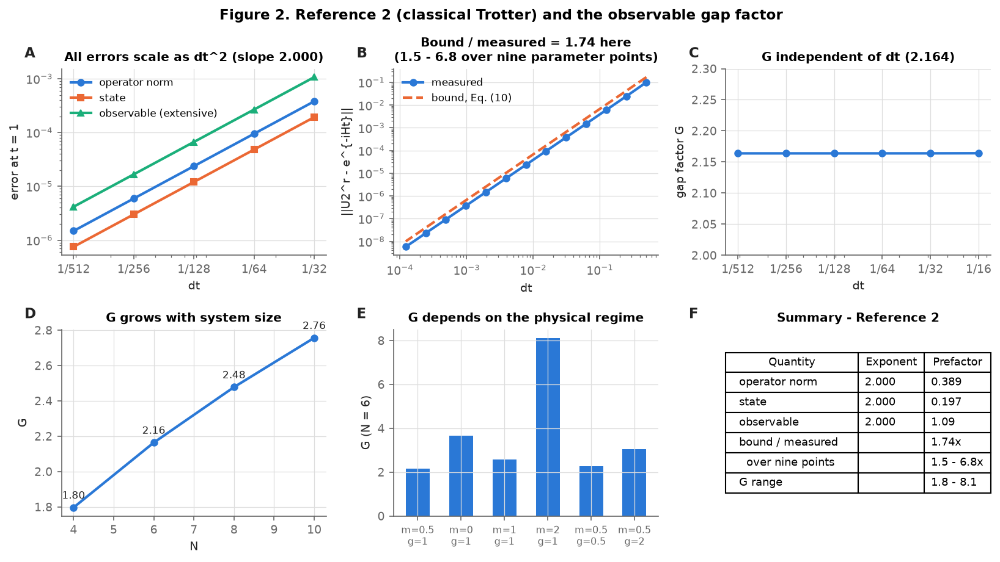
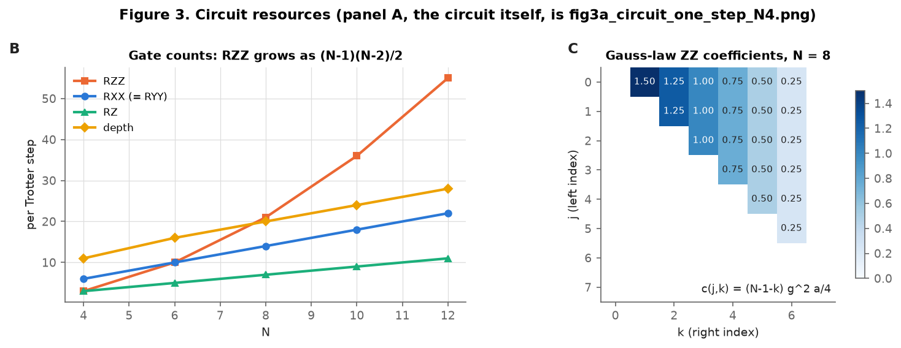
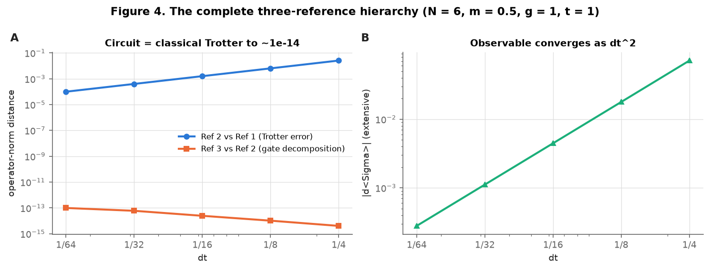
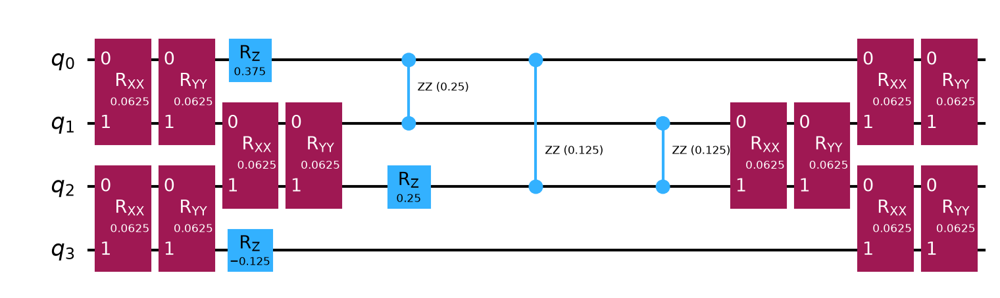
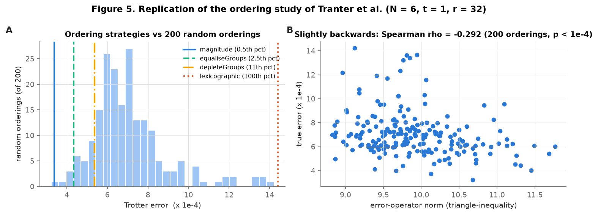

# Schwinger testbed

**A validated quantum-circuit testbed for the lattice Schwinger model**

[](https://github.com/Moein-Sahraei/schwinger-testbed/actions/workflows/check.yml)
[](https://doi.org/10.5281/zenodo.22703884)
[](LICENSE)

Moein Sahraei, Department of Physics, Razi University, Kermanshah, Iran ·
ORCID [0009-0008-8672-3934](https://orcid.org/0009-0008-8672-3934)

This repository contains the code for the preprint
*A Validated Quantum-Circuit Testbed for the Lattice Schwinger Model*
(Zenodo, 2026; [10.5281/zenodo.22703884](https://doi.org/10.5281/zenodo.22703884)).
An earlier version of the preprint appeared as
*A Validated Three-Reference Quantum-Circuit Testbed for the Lattice Schwinger Model*
([10.5281/zenodo.21854391](https://doi.org/10.5281/zenodo.21854391)); this code reproduces the current version.

## What the project does

The lattice Schwinger model (1+1D QED, Kogut–Susskind staggered fermions, open boundaries, gauge field
eliminated through Gauss's law) is written as a spin chain and simulated with three references:

| Reference | Method | What the comparison checks |
|---|---|---|
| 1 | Exact diagonalization / exact evolution | the physics (validated against analytic limits) |
| 2 | Classical second-order (Strang) Trotter evolution | Ref 2 vs Ref 1 isolates the physical Trotter error |
| 3 | Gate-level Qiskit circuit (RXX, RYY, RZ, RZZ) | Ref 3 vs Ref 2 checks the gate decomposition |

References 1 and 2 are independent. References 2 and 3 share the Hamiltonian, so their agreement to machine
precision verifies the circuit implementation, not the physics; the physics is checked against Reference 1.
Each comparison therefore isolates a single approximation. The testbed is then used on questions from the
literature:

1. **Commutator-scaling bound** (Childs et al., PRX 11, 011020, 2021): the bound overestimates the measured
   operator-norm error by 1.74 at the reference point, constant over Δt, and by 1.5–6.8 across nine
   parameter points (median 2.0).
2. **Observable gap factor** G = 2‖O‖‖Δψ‖ / |Δ⟨O⟩|: independent of Δt (2.164), matching its leading-order
   expression (Eq. 12); its growth with system size is the growth of the state error, while the error of a
   local observable stays constant (the local-versus-global picture of Heyl, Hauke and Zoller, 2019).
3. **Term ordering** (Tranter et al., Entropy 21, 1218, 2019): all four of their trends transfer; the
   norm-based error estimator ranks orderings slightly backwards (Spearman ρ = −0.292 over 200 orderings).
4. **Beyond exact diagonalization**: a matrix-product-state version of the same Hamiltonian, with the
   long-range Gauss-law couplings carried by a matrix-product operator, reproduces the exact ground-state
   energy for N ≤ 12 and reaches N = 30 at bond dimension χ = 96.

## Quick start

Python 3.11 is used for testing (GitHub Actions). From the top folder of the repository:

```bash
pip install -r requirements.txt
python code/run_all.py            # full run, about 2 minutes
python code/run_all.py --quick    # skips N = 10 and the large MPS runs, about 20 s
```

Every script prints a `[PASS]` / `[FAIL]` line for each number it compares with the preprint, ends with
`SUCCESS: ...`, and exits with status 1 if any check fails. The full run makes **193 checks**
(the quick run 177).

## Scripts

All scripts run from the top folder, e.g. `python code/schwinger_ed.py`.

| Script | Preprint section | What it reproduces |
|---|---|---|
| `code/schwinger_core.py` | Eqs. (2)–(3), (6)–(9) | Hamiltonian, Pauli form, Trotter step, helper functions (library) |
| `code/schwinger_circuit_lib.py` | Eq. (13) | Qiskit circuit for one Trotter step (library) |
| `code/schwinger_ed.py` | Sec. 2.2, Table 1, Fig. 1 | Reference 1 checks; equivalence with Nguyen et al. (PRX Quantum 3, 020324) |
| `code/schwinger_pauli.py` | Sec. 2.3 | Pauli decomposition, diagonal H₂, Gauss-law ZZ coefficients |
| `code/schwinger_trotter.py` | Sec. 4.2, Table 2 | exponents and prefactors of the three error measures |
| `code/schwinger_commutator.py` | Sec. 4.3, Eq. (10), Result 1 | nested commutators, bound ratio at the reference point and at nine parameter points, prefactors 1/24 and 1/12 |
| `code/schwinger_proper_gap.py` | Sec. 5, Eqs. (11)–(12), Table 3, Results 2–4 | gap factor G, its Δt independence and leading-order formula, the single-site decomposition |
| `code/schwinger_circuit.py` | Sec. 6.1, 6.3, Table 5 | circuit = classical propagator; gate counts and depth |
| `code/schwinger_hierarchy.py` | Sec. 6.2, Table 4, Result 5 | the complete three-reference hierarchy |
| `code/schwinger_ordering.py` | Sec. 7, Table 6, Results 6–7 | ordering strategies and the Spearman test |
| `code/schwinger_mps.py` | Sec. 8.4 | matrix-product states (TeNPy DMRG) against exact diagonalization, up to N = 30 |
| `code/make_figures.py` | Figs. 1–5 | regenerates the figures from `results/` |
| `code/run_all.py` | — | runs everything and prints a summary |

Numerical results are written to `results/` (JSON and CSV); figures to `figures/`.

## Key numbers: preprint vs this code

Default parameters: N = 6, m = 0.5, g = 1, a = 1, t = 1, initial state |1010…⟩.

| Quantity | Preprint | This code |
|---|---|---|
| ‖[H₁,H₂]‖ for N = 4, 6, 8, 10 | 1.609, 2.551, 3.813, 5.376 | 1.6093, 2.5507, 3.8132, 5.3759 |
| Free-field limit error, N = 4, 6, 8 | < 10⁻¹⁴ | < 10⁻¹⁴ |
| Chiral condensate at m = 20 | −0.4997 | −0.49975 |
| Fitted exponents (operator, state, observable) | 2.000, 2.000, 2.000 | 2.0000, 2.0000, 2.0000 |
| Prefactors (operator, state, observable) | 0.389, 0.197, 1.09 | 0.3888, 0.1973, 1.094 |
| ‖[H₁,[H₁,H₂]]‖, ‖[H₂,[H₁,H₂]]‖ | 3.750, 6.254 | 3.7500, 6.2541 |
| Bound coefficient, Eq. (10) | 0.6774 | 0.67743 |
| **Bound / measured, reference point, Δt ∈ [1/512, 1/16]** | **1.74** | **1.742–1.743** |
| **Bound / measured, nine points: min, median, max** | **1.51, 2.01, 6.84** | **1.510, 2.014, 6.836** |
| Bound / measured for N = 4 → 10 | 1.81 → 2.31 | 1.810 → 2.310 |
| Bound / measured for g = 0.5 → 2 | 1.57 → 6.84 | 1.574 → 6.836 |
| Extracted prefactors c₁, c₂ | 1/24, 1/12 | 0.0416665, 0.0833334 |
| Normalisation artifact ratio, N = 4…10 | 8, 12, 16, 20 | 8, 12, 16, 20 |
| **G (chiral condensate), Δt ∈ [1/512, 1/16]** | **2.164** | **2.1638–2.1640** |
| Relative Δt² coefficient of G | ≈ 0.025 | 0.026 |
| G from Eq. (12), E extracted at Δt = 1/2048 | 2.163812 | 2.1638126 |
| Measured G minus Eq. (12) at Δt = 1/16 | 2.2 × 10⁻⁴ | 2.16 × 10⁻⁴ |
| Anticommutator instead of commutator in Eq. (12) | 25.79 | 25.785 |
| G for N = 4, 6, 8, 10 | 1.80, 2.16, 2.48, 2.76 | 1.797, 2.164, 2.478, 2.757 |
| G range over Table 3 | 1.8–8.1 | 1.80–8.10 |
| Single-site σᶻ₀: ‖Δψ‖ for N = 4, 6, 8, 10 | 9.319, 12.04, 14.25, 16.17 × 10⁻⁶ | 9.319, 12.04, 14.25, 16.17 × 10⁻⁶ |
| Single-site σᶻ₀: \|Δ⟨σᶻ₀⟩\| for N = 4, 6, 8, 10 | 7.2653, 7.2637, 7.2637, 7.2637 × 10⁻⁶ | 7.2653, 7.2637, 7.2637, 7.2637 × 10⁻⁶ |
| Single-site σᶻ₀: G for N = 4, 6, 8, 10 | 2.565, 3.315, 3.924, 4.452 | 2.565, 3.315, 3.924, 4.452 |
| Growth N = 4 → 10: ‖Δψ‖, \|Δ⟨Σ⟩\|, G(Σ) | 1.735, 2.83, 1.53 | 1.735, 2.827, 1.534 |
| Ref 2 vs Ref 1, r = 4, 8, 16, 32, 64 | 2.58e-2, 6.40e-3, 1.60e-3, 3.99e-4, 9.97e-5 | 2.58e-2, 6.40e-3, 1.60e-3, 3.99e-4, 9.97e-5 |
| Ref 3 vs Ref 2 (machine precision), r = 64 | 7.6e-14 | 9.9e-14 |
| Fitted Trotter exponent (Ref 2 vs Ref 1) | 2.003 | 2.0033 |
| Gate counts per step, N = 4 … 12 (total) | 18, 35, 56, 81, 110 | 18, 35, 56, 81, 110 |
| Circuit depth, N = 6, r = 32 | 513 | 513 |
| Ordering errors: magnitude, equalise, deplete, lexicographic | 3.38e-4, 4.35e-4, 5.36e-4, 1.44e-3 | 3.380e-4, 4.347e-4, 5.360e-4, 1.440e-3 |
| Percentiles among 200 random orderings | 0.5, 2.5, 11.0, 100 | 0.5, 2.5, 11.0, 100 |
| Random-ordering span | 3.23e-4 – 1.42e-3 (×4.40) | 3.231e-4 – 1.422e-3 (×4.40) |
| **Spearman ρ (error-operator norm vs true error), 200 orderings** | **−0.292 (p < 10⁻⁴)** | **−0.2924 (p = 2.7 × 10⁻⁵)** |
| MPS ground-state energy vs exact, N = 4 … 12 | 10⁻¹⁴ or better | ≤ 4 × 10⁻¹⁴ |
| MPS: N = 30 at χ = 96 | reached | E₀ = −11.363802, energy variance 3 × 10⁻¹² |

## Figures

| | |
|---|---|
|  |  |
| **Fig. 1** Reference 1: exact diagonalization | **Fig. 2** Reference 2 and the gap factor G |
|  |  |
| **Fig. 3** Circuit resources | **Fig. 4** The three-reference hierarchy |
|  |  |
| **Fig. 3A** One Trotter step, N = 4 | **Fig. 5** Ordering strategies |

## Conventions and notes on reproduction

* **Norms.** ‖·‖ is the spectral norm (largest singular value) throughout.
* **Qubit order.** Site n is qubit n, little-endian as in Qiskit. The vacuum |1010…⟩ has site 0 in |1⟩.
* **Global phase.** Identity terms are dropped from the circuit, so circuit and classical propagators are
  compared up to a global phase.
* **Machine-precision values.** Distances at the 10⁻¹⁴ level depend on the order of floating-point
  operations and differ from the preprint in the last digits (e.g. 9.9×10⁻¹⁴ instead of 7.6×10⁻¹⁴ at
  r = 64). The checks require these to stay below 10⁻¹². The same applies to the MPS energies: the
  differences from exact diagonalization are at the 10⁻¹⁴ level (up to 4×10⁻¹⁴ here), and the check
  requires them to stay below 10⁻¹³.
* **Bound ratio.** At the reference point the ratio is 1.742–1.743 for every Δt in [1/512, 1/16]; the CSV
  `results/bound_vs_measured_N6.csv` extends the comparison from Δt = 1/2 to 1/8192. The nine-point values
  (`results/bound_ratio_nine_points.csv`) use Δt = 1/128, the step of Table 3.
* **Eq. (12).** The error operator is extracted from e^{iHt} U₂ʳ = 1 − iεE with ε = tΔt². Extracted once at
  Δt = 1/2048 it gives G = 2.1638126; re-extracted at each Δt in [1/512, 1/16] it gives the same value to
  within 1×10⁻⁶ (2.1638105–2.1638118), because E is Δt-independent at leading order. The measured G
  approaches this value as Δt² (`results/gap_vs_dt_N6.csv`).
* **Single-site observable.** |Δ⟨σᶻ₀⟩| is identical to five figures for N = 6, 8, 10; the N = 4 value differs
  from them by 2×10⁻⁴ (relative), as in the preprint's table.
* **Ordering study.** Magnitude ordering uses a stable sort of the term list; the lexicographic order sorts
  Pauli strings written site 0 first; commuting groups come from greedy colouring (rustworkx, *Degree*
  strategy) of the anticommutation graph. Random orderings use `numpy.random.default_rng(7)`; the same 200
  orderings are used for Table 6 and for the Spearman test, where the error-operator norm is the
  triangle-inequality norm of the second-order error operator of Tranter et al.
* **Matrix-product states.** `code/schwinger_mps.py` builds the MPO from the same Pauli decomposition as the
  circuit (checked against the directly built Hamiltonian), runs two-site DMRG with TeNPy (χ = 64 for
  N ≤ 12, χ = 96 for N = 16–30, 40 sweeps with mixer), and reports the energy variance ⟨H²⟩ − ⟨H⟩² as a
  convergence measure. Only ground states are computed; time evolution with this long-range MPO is the
  open direction named in the preprint's outlook.
* **Figures** are regenerated from the computed data; they show the same quantities as the preprint
  figures, with a lighter layout.
* All results are noiseless (no hardware noise model).

## Citation

If you use this code, please cite the preprint (see also `CITATION.cff`):

```bibtex
@misc{sahraei2026schwinger,
  author       = {Sahraei, Moein},
  title        = {A Validated Quantum-Circuit Testbed for the Lattice Schwinger Model},
  year         = {2026},
  publisher    = {Zenodo},
  doi          = {10.5281/zenodo.22703884},
  note         = {Department of Physics, Razi University, Kermanshah, Iran}
}
```

## References

1. A. M. Childs, Y. Su, M. C. Tran, N. Wiebe, S. Zhu, *Theory of Trotter Error with Commutator Scaling*,
   Phys. Rev. X **11**, 011020 (2021).
2. J. Kogut, L. Susskind, *Hamiltonian formulation of Wilson's lattice gauge theories*, Phys. Rev. D **11**,
   395 (1975).
3. M. C. Bañuls et al., *Simulating lattice gauge theories within quantum technologies*, Eur. Phys. J. D
   **74**, 165 (2020).
4. L. Gao, S. Choi, A. F. Izmaylov, *Estimating Trotter approximation errors to optimize Hamiltonian
   partitioning for lower eigenvalue errors*, arXiv:2312.13282 (2023).
5. M. Heyl, P. Hauke, P. Zoller, *Quantum localization bounds Trotter errors in digital quantum simulation*,
   Sci. Adv. **5**, eaau8342 (2019).
6. A. Tranter, P. J. Love, F. Mintert, N. Wiebe, P. V. Coveney, *Ordering of Trotterization: Impact on
   Errors in Quantum Simulation of Electronic Structure*, Entropy **21**, 1218 (2019).
7. N. H. Nguyen et al., *Digital Quantum Simulation of the Schwinger Model and Symmetry Protection with
   Trapped Ions*, PRX Quantum **3**, 020324 (2022).
8. J. Hauschild, F. Pollmann, *Efficient numerical simulations with Tensor Networks: Tensor Network Python
   (TeNPy)*, SciPost Phys. Lect. Notes 5 (2018).

## License

MIT — see `LICENSE`.
